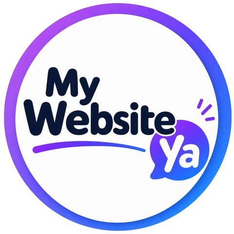

# PROPUESTA COMERCIAL
## Estrategia de Generación de Oportunidades Comerciales para Preventus

---

### **Presentado a:** Preventus (Seguridad y Salud en el Trabajo - SST)  
### **Elaborado por:** My Website Ya  
### **Vigencia de la propuesta:** 15 días (Hasta Octubre 17, 2026)  
### **Logo de Agencia:**   
### **Logo de Cliente:** 

---

## 1. El Objetivo

La propuesta para **Preventus** busca convertir la inversión digital en un **sistema constante de generación de conversaciones y oportunidades comerciales** dentro del mercado de **Seguridad y Salud en el Trabajo (SST)**.

Trabajaremos sobre tres pilares fundamentales:

$$\text{ATRAER} \longrightarrow \text{CONVERSAR} \longrightarrow \text{CONVERTIR}$$

El objetivo inicial será generar aproximadamente **100 conversaciones iniciadas por semana**, utilizando campañas digitales, contenido de valor y una experiencia de atención optimizada en WhatsApp.

---

## 2. Inversión Propuesta (Plan Base Core)

| Concepto | Inversión Mensual |
| :--- | :--- |
| **Inversión en publicidad digital (Meta Ads)** | $3.000.000 COP |
| **Administración y estrategia** | $2.000.000 COP |
| **INVERSIÓN TOTAL MENSUAL BASE** | **$5.000.000 COP** |

### ¿Qué significa cada inversión?
* **Los $3.000.000 COP** son destinados directamente a pauta publicitaria en redes sociales (Meta Ads / Instagram / Facebook).
* **Los $2.000.000 COP** corresponden al trabajo estratégico y operativo necesario para que esa inversión tenga seguimiento, optimización y una ruta clara hacia la conversión.

---

## 3. ¿Por qué $2.000.000 COP de Administración?

La administración no consiste únicamente en “publicar anuncios”. El objetivo es **construir y optimizar un embudo comercial digital** integral para Preventus.

Por eso, la gestión incluye:

### A. Estrategia y Campañas
* **Planeación mensual de campañas:** Estrategia adaptada a metas de ventas.
* **Definición y análisis de públicos relacionados con SST:** Segmentación de gerentes HSEQ, directores de RRHH y responsables de SST.
* **Campañas orientadas a conversación:** Configuración enfocada en tráfico calificado a chat.
* **Pruebas A/B:** Testeo de diferentes públicos, mensajes y propuestas de valor.
* **Optimización constante:** Ajuste de anuncios y redistribución del presupuesto hacia los contenidos con mejor comportamiento.

### B. Creación de Contenido
Se desarrollará contenido en formato **Reels**, diseñado específicamente para captar la atención de empresas y responsables de SST.

Los contenidos abordarán:
1. Problemas frecuentes de las empresas en SST.
2. Errores que pueden generar riesgos o sanciones.
3. Recomendaciones prácticas.
4. Casos y situaciones empresariales reales.
5. Educación sobre cumplimiento y prevención.
6. Servicios y soluciones de Preventus.
7. Preguntas frecuentes de clientes.

> **Ejemplo de Call to Action (CTA):**  
> *“¿Tu empresa necesita apoyo en SST? Escríbenos por WhatsApp y te contamos cómo podemos ayudarte.”*

---

## 4. MÓDULO OPCIONAL DE ALTO IMPACTO: Posicionamiento Selectivo en Google (+ $5.000.000 COP)

### ¿Por qué incluir el Posicionamiento en Google?
Debido al **alto impacto mediático y comercial** que posee la red de búsqueda de Google, este módulo opcional permite capturar directamente a prospectos en el momento preciso en que tienen la necesidad activa de contratación.

* **Posicionamiento Selectivo y de Alta Precisión:** Al contar con un presupuesto dedicado de **$5.000.000 COP adicionales**, posicionamos a Preventus en las palabras clave comerciales más codiciadas de la industria SST (ej: *“cotizar SG-SST empresas”*, *“auditoría riesgos laborales Colombia”*, *“consultoría prevención SST”*).
* **Intención Comercial Inmediata:** A diferencia de las redes sociales, quien busca en Google ya tiene el presupuesto asignado y la urgencia de contratar un proveedor de SST.
* **Prospectos de Mayor Ticket / Empresa:** Atrae a empresas medianas y grandes que licitan o buscan soluciones integrales.

---

## 5. WhatsApp: Convertir Conversaciones en Oportunidades

Generar conversaciones no es suficiente si no reciben una atención adecuada. Por eso, la estrategia optimiza el proceso de respuesta comercial:

Se trabajará en:
* Mensaje inicial de bienvenida.
* Preguntas de calificación comercial.
* Respuestas rápidas y plantillas estandarizadas.
* Estructura efectiva de la conversación.
* Identificación clara de la necesidad del cliente.
* Llamados a la acción.
* Flujo de atención comercial continuo.
* Reducción de pasos innecesarios para solicitar información.
* Recomendaciones para mejorar el tiempo de respuesta.

$$\text{Anuncio} \longrightarrow \text{WhatsApp} \longrightarrow \text{Conversación} \longrightarrow \text{Calificación} \longrightarrow \text{Cotización} \longrightarrow \text{Venta}$$

---

## 6. Meta Inicial de Generación

$$\mathbf{100\text{ conversaciones iniciadas por semana}} \quad \approx \quad \mathbf{400\text{ conversaciones al mes (Plan Base Meta)}}$$

Costo promedio de referencia meta: **~$7.500 COP por conversación**.  
*(Con el módulo opcional de Google, se incrementa el volumen de prospectos de alta intención comercial).*

---

## 7. ¿Cómo Mediremos el Retorno?

El seguimiento estará estrictamente orientado al **resultado comercial**:

$$\text{Conversaciones} \longrightarrow \text{Prospectos Calificados} \longrightarrow \text{Cotizaciones} \longrightarrow \text{Clientes} \longrightarrow \text{Facturación Generada}$$

---

## 8. Indicadores Principales (Dashboard de Control)

| Indicador | Frecuencia de Seguimiento |
| :--- | :--- |
| **Inversión publicitaria (Meta + Google)** | Mensual |
| **Conversaciones iniciadas** | Semanal / mensual |
| **Costo por conversación (CPA)** | Semanal / mensual |
| **Prospectos calificados** | Mensual |
| **Cotizaciones generadas** | Mensual |
| **Clientes adquiridos** | Mensual |
| **Costo de adquisición (CAC)** | Mensual |
| **Ventas generadas (Facturación)** | Mensual |
| **Retorno de inversión (ROAS / ROI)** | Mensual |

---

## 9. La Propuesta en una Frase

> **Preventus no estaría pagando $2.000.000 COP solamente por administrar publicidad; estaría invirtiendo en la construcción, seguimiento y optimización de un sistema digital orientado a generar oportunidades comerciales.**
>
> * Los **$3.000.000 COP** ponen el presupuesto frente al mercado objetivo en redes sociales.
> * Los **$2.000.000 COP** permiten gestionar, analizar, optimizar y mejorar el camino entre la publicidad y la venta.
> * Los **$5.000.000 COP (Opcional)** capturan la demanda directa de alto valor en el buscador de Google.

---

## 10. Opciones de Inversión Mensual Consolidada

### **OPCIÓN A: PLAN CORE (REDES SOCIALES & WHATSAPP)**
* **Inversión Pauta Meta:** $3.000.000 COP
* **Administración y Estrategia:** $2.000.000 COP
* **TOTAL MENSUAL OPCIÓN A:** **$5.000.000 COP**

---

### **OPCIÓN B: PLAN INTEGRAL PREMIUM (META + POSICIONAMIENTO SELECTIVO GOOGLE)**
* **Inversión Pauta Meta:** $3.000.000 COP
* **Administración y Estrategia:** $2.000.000 COP
* **Módulo Opcional Posicionamiento Google:** $5.000.000 COP
* **TOTAL MENSUAL OPCIÓN B:** **$10.000.000 COP**

---

### Notas y Condiciones:
* La inversión publicitaria se destina directamente a las plataformas correspondientes.
* **Vigencia de la propuesta:** 15 días.
* *La meta de 100 conversaciones semanales es un objetivo de referencia estratégico para la optimización continua de las campañas.*

---
*Propuesta elaborada por My Website Ya para Preventus SST.*
